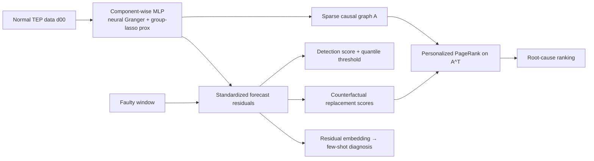
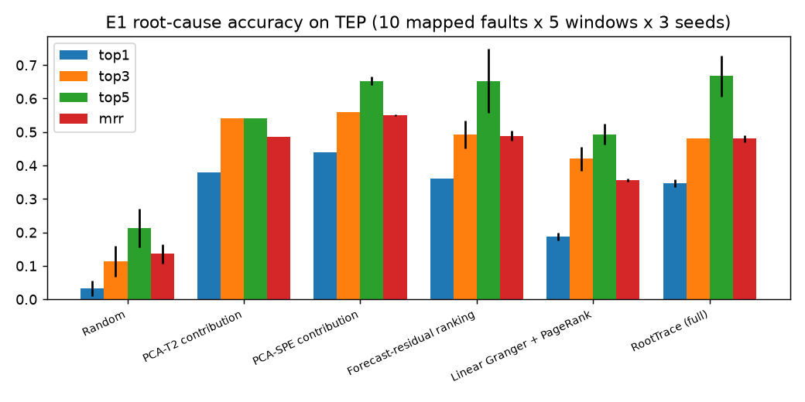
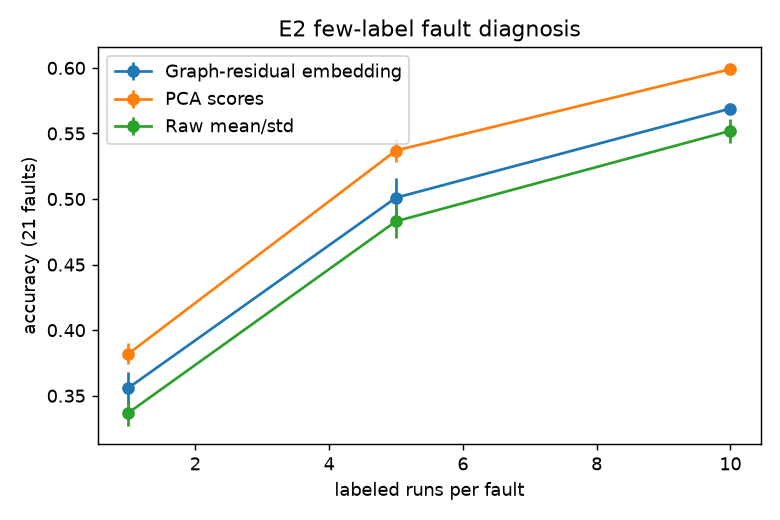
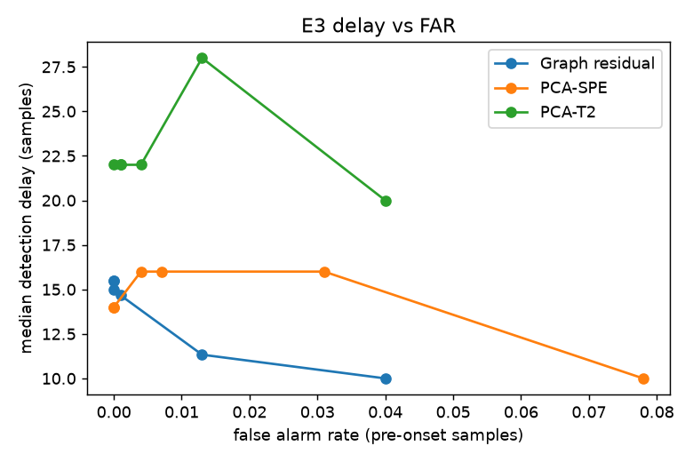
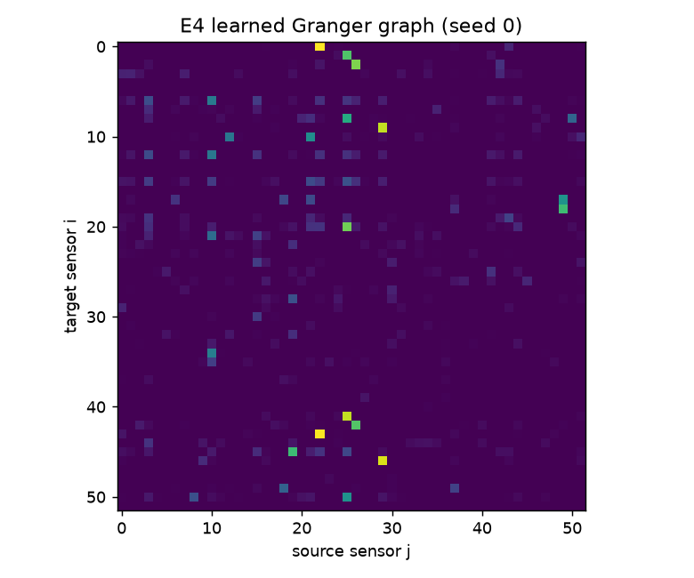

# RootTrace — Neural-Granger Graphs + Counterfactual Propagation for Industrial Root-Cause Analysis

**Author:** Hossein Tabasi · MIT License

RootTrace learns a sparse, *nonlinear* Granger-causal graph of a chemical process from normal operation, uses the
graph's forecast residuals as a fault-sensitive representation, and ranks root-cause sensors by combining
**counterfactual sensor replacement** with a **personalized PageRank walk from effects back to causes**.
Evaluated on the Tennessee Eastman Process (TEP) against PCA-T²/SPE contribution plots, linear Granger + PageRank
and forecast-residual ranking.

## Problem
Given 52 TEP variables (41 XMEAS + 11 XMV) and a detected fault, (i) detect it quickly with few false alarms,
(ii) rank the variables most likely to be the *origin* of the disturbance, (iii) diagnose the fault type from few labels.

## Method
**1. Component-wise neural Granger model.** For each variable *j*, an MLP forecasts x_j(t) from the lagged window
X(t−L:t−1) (L = 5). The first-layer weights W_j are grouped by input variable *i*, and a group-lasso proximal step

  W_j[:, i, :] ← W_j[:, i, :] · max(0, 1 − ηλ / ‖W_j[:, i, :]‖₂)

drives entire input groups to zero. Edge strength A_ij = ‖W_j[:, i, :]‖₂. λ = 5.0 was chosen **on normal validation
data only** (`scripts/select_sparsity.py`: the largest λ within 5% of the best validation MSE), giving ≈470 of 2652 edges.

**2. Residual representation.** r_j(t) = (x_j(t) − x̂_j(t)) / σ_j(normal). Detection score s(t) = mean over a window of ‖r(t)‖²,
with thresholds at normal-data quantiles.

**3. Counterfactual replacement.** For each candidate i, replace the trajectory of x_i in the fault window with the model's
one-step-ahead (normal-behaviour) prediction x̂_i and measure the drop in residual energy: c_i = E(X) − E(X_{i←x̂_i}). Variables whose removal "explains away" the anomaly score high.

**4. Effect→cause propagation.** Personalized PageRank that walks from each node to its Granger parents (P = row-normalized A, A[i,j] = strength of j→i),
π = α v + (1−α) πP, with teleport vector v ∝ counterfactual scores and α = 0.3. Final rank = π.



## Data
Tennessee Eastman Process, classic Braatz files (d00–d21, training + `_te` test runs with fault onset at sample 160),
public mirror <https://github.com/camaramm/tennessee-eastman-profBraatz>. Process description: Downs & Vogel (1993).
Root-cause ground truth (`src/roottrace/ground_truth.py`) is a variable set per IDV derived from the disturbance
descriptions in Downs & Vogel (1993) for the 10 faults with an unambiguous physical entry point (IDV 1,2,4,5,6,7,11,12,14,15);
a hit means any variable of the set is ranked at position ≤ k. Known edges for E4 are 12 valve→flow pairs (XMV → its measured flow).

## Quickstart
```bash
pip install -r requirements.txt && pip install -e .
bash scripts/download_data.sh          # clones TEP; then export TEP_DIR=...
python3 -m pytest -q                   # 8 tests
python3 scripts/select_sparsity.py     # optional: λ selection on normal validation data
python3 scripts/run_all.py             # E1–E5, writes experiments/results/*.csv and figures/*.png
```
Config: `configs/default.yaml`. CPU only (≈ tens of minutes). Seeds 0,1,2; mean ± std reported.

## Results (all numbers from `experiments/results/`)

### E1 + E5 — Root-cause ranking (10 faults × 3 seeds) and ablations
| Method | Top-1 | Top-3 | Top-5 | MRR |
|---|---|---|---|---|
| PCA-SPE contribution | 0.440 ± 0.000 | 0.560 ± 0.000 | 0.653 ± 0.012 | **0.551 ± 0.002** |
| Ablation: no propagation (counterfactual only) | 0.393 ± 0.023 | 0.493 ± 0.050 | 0.607 ± 0.023 | 0.494 ± 0.027 |
| Forecast-residual ranking | 0.360 ± 0.000 | 0.493 ± 0.042 | 0.653 ± 0.095 | 0.489 ± 0.016 |
| PCA-T² contribution | 0.380 ± 0.000 | 0.540 ± 0.000 | 0.540 ± 0.000 | 0.485 ± 0.000 |
| **RootTrace (full)** | 0.347 ± 0.012 | 0.480 ± 0.000 | **0.667 ± 0.061** | 0.480 ± 0.010 |
| Ablation: linear graph | 0.387 ± 0.012 | 0.460 ± 0.020 | 0.593 ± 0.046 | 0.473 ± 0.005 |
| Linear Granger + PageRank | 0.187 ± 0.012 | 0.420 ± 0.035 | 0.493 ± 0.031 | 0.356 ± 0.005 |
| Ablation: no counterfactual (PageRank on residuals) | 0.000 ± 0.000 | 0.500 ± 0.040 | 0.660 ± 0.040 | 0.307 ± 0.010 |
| Random | 0.033 ± 0.023 | 0.113 ± 0.046 | 0.213 ± 0.058 | 0.136 ± 0.029 |

Restart-probability sensitivity (reported, *not* used for selection): α=0.1 → MRR 0.309, α=0.5 → 0.481, α=0.8 → 0.486.



### E2 — Few-label fault diagnosis (kNN on embeddings, k labelled windows per class)
Accuracy over 21 classes; and excluding IDV 3/9/15, which are widely reported as practically indistinguishable from normal.

| Embedding | k=1 | k=5 | k=10 | k=1 (excl. 3/9/15) | k=5 (excl.) | k=10 (excl.) |
|---|---|---|---|---|---|---|
| PCA scores | **0.382 ± 0.008** | **0.537 ± 0.009** | **0.599 ± 0.003** | **0.424** | **0.603** | **0.674** |
| Graph-residual embedding | 0.356 ± 0.012 | 0.501 ± 0.015 | 0.569 ± 0.003 | 0.386 | 0.551 | 0.626 |
| Raw mean/std | 0.337 ± 0.010 | 0.483 ± 0.013 | 0.552 ± 0.009 | 0.368 | 0.533 | 0.612 |



### E3 — Detection delay vs. false-alarm rate (threshold = normal-data quantile)
| Detector | Quantile | FAR | Median delay (samples) | Faults with an alarm (of 21) |
|---|---|---|---|---|
| **Graph residual** | 0.95 | **0.013 ± 0.003** | **11.3 ± 2.3** | 21 |
| PCA-SPE | 0.95 | 0.031 | 16 | 21 |
| PCA-T² | 0.95 | 0.013 | 28 | 21 |
| **Graph residual** | 0.99 | 0.000 | 15.5 ± 2.3 | 19 ± 1 |
| PCA-SPE | 0.99 | 0.004 | 16 | 19 |
| PCA-T² | 0.99 | 0.001 | 22 | 17 |

(PCA rows are deterministic, so std is not applicable. "With an alarm" means at least one post-onset alarm; it says nothing about the
hard faults being reliably detected.)



### E4 — Graph sanity and stability
| Graph | Known valve→flow pairs recovered in top-150 edges | Non-zero edges |
|---|---|---|
| Neural Granger (seeds 0/1/2) | 0.667 / 0.667 / 0.667 | 467 / 499 / 470 |
| Linear Granger (F-test) | 0.500 | 71 |
| Random top-150 (expected) | 0.110 | 150 |

Top-150 edge Jaccard across seeds: 0.775 (0-1), 0.754 (0-2), 0.714 (1-2).



## Honest findings and limitations
- **RootTrace does not beat the PCA-SPE contribution baseline on root-cause MRR** (0.480 vs 0.551). It is better only on Top-5
  and is clearly better than linear Granger + PageRank (0.356) and random (0.136).
- Propagation adds no value over counterfactual scores alone on this sparse graph (0.494 vs 0.480). PageRank *without* the
  counterfactual teleport collapses (Top-1 = 0): it concentrates mass on hub variables.
- The clearest wins are in **detection** (lower delay at equal or lower FAR than PCA-SPE/T²) and **graph quality** (stable across seeds,
  better recovery of known physical edges than linear Granger).
- For few-label diagnosis, the residual embedding beats raw statistics but is **below PCA scores**.
- The ground-truth root-cause sets are a hand-built mapping from disturbance descriptions (10 faults). They are coarse, and results
  depend on that mapping. TEP is simulated data, and there is a single test run per fault.

## Citation
```bibtex
@software{tabasi2026roottrace,
  author = {Hossein Tabasi},
  title  = {RootTrace: Neural-Granger Graphs and Counterfactual Propagation for Industrial Root-Cause Analysis},
  year   = {2026},
  url    = {https://github.com/hosseinTabasi/roottrace-industrial-rca}
}
```
References: J. J. Downs, E. F. Vogel, "A plant-wide industrial process control problem," *Computers & Chemical Engineering* 17(3), 1993.
A. Tank et al., "Neural Granger Causality," *IEEE TPAMI* 2022.
